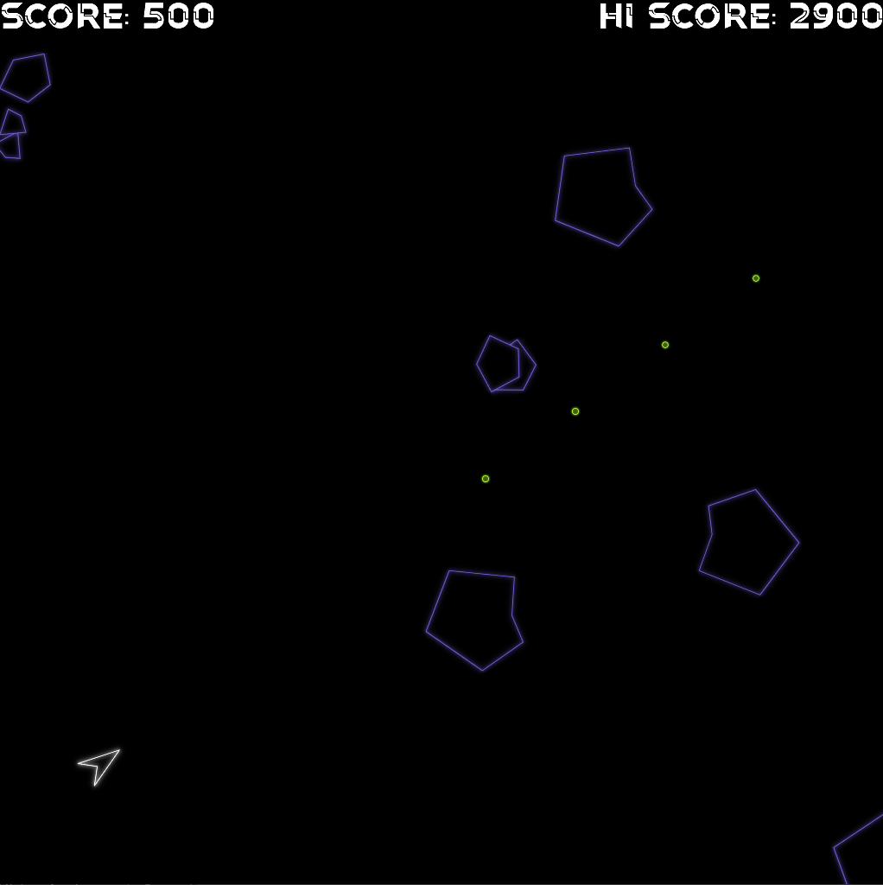
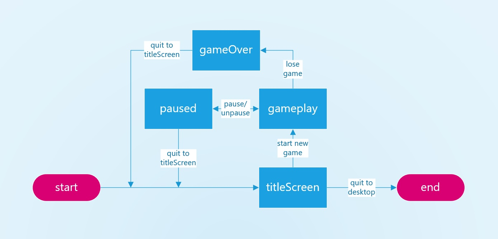

# Asteroids

We will make a clone of the classic game Asteroids. It should make use of:
- hierarchal classes
- a finite state machine
- enums
- a text-based UI
- file reading/writing to store a hi-score

When finished, zip up your project folder and upload it below.

---

Here is the simple finite state machine for our Asteroids project.

